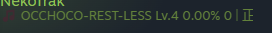

# MuseDashTrak

Show your **Muse Dash** gameplay on **NekoTrak**'s Steam / Discord rich presence.



```
🔥 OCCHOCO-REST-LESS Lv.4 98.42% 129880 · 258x
🏁 OCCHOCO-REST-LESS Lv.4 99.82% 129880
```

While you play, the presence shows the song title, chart level, accuracy, score and
combo. After the song it briefly keeps the final result. When you are not playing,
the status item is empty.

---

## How it works

```
Muse Dash ──[MelonLoader mod]──> %LOCALAPPDATA%\MuseDashTrak\status.json
                                              │
NekoTrak custom status  ${...\mdt-status.exe} ┘
```

* **`MuseDashTrak.dll`** – a MelonLoader mod. Every 0.5 s it reads the game's IL2CPP
  objects (`GlobalDataBase.s_DbBattleStage`, `TaskStageTarget`,
  `BattleRoleAttributeComponent`, …) **by name** through the `il2cpp_*` API exported
  by `GameAssembly.dll`, and writes `status.json`.
  No hard-coded memory offsets, so small game updates usually keep working.
* **`mdt-status.exe`** – executed by NekoTrak every time it refreshes the presence.
  It reads `status.json` and prints one line of text.
* **NekoTrak** – the installer adds a custom status item to `steamSyncItems`
  that contains `${...\mdt-status.exe}`. NekoTrak runs that command and
  substitutes its output.

---

## Requirements

| | |
|---|---|
| OS | Windows 10 / 11 (x64) |
| Game | [Muse Dash](https://store.steampowered.com/app/774171/Muse_Dash/) (Steam) |
| Host app | [NekoTrak](https://store.steampowered.com/app/5249210/NekoTrak/) 1.3.x |
| Mod loader | [MelonLoader](https://github.com/LavaGang/MelonLoader) 0.7.0 (downloaded by the installer) |

---

## Install

1. Download `MuseDashTrak-vX.Y.Z.zip` from [Releases](../../releases).
2. **Quit NekoTrak** (tray icon → Quit) and Muse Dash.
3. Unzip and run **`install.cmd`**.
4. Start NekoTrak, then launch Muse Dash **through Steam** and play a song.

The first launch with MelonLoader generates IL2CPP assemblies (1–3 minutes, a
console window shows the progress). Later launches are fast.

Game installed somewhere unusual?

```powershell
powershell -ExecutionPolicy Bypass -File .\install\install.ps1 -GamePath "E:\SteamLibrary\steamapps\common\Muse Dash"
```

---

## Customize the text

Edit `%LOCALAPPDATA%\MuseDashTrak\format.txt`:

* line 1 – template while playing
* line 2 – template after the song

| Placeholder | Meaning | Placeholder | Meaning |
|---|---|---|---|
| `{song}` | song title | `{lv}` | ` Lv.9` (empty when unknown) |
| `{level}` | chart level, e.g. `9` | `{diffName}` | `EASY` / `HARD` / `MASTER` / `HIDDEN` / `TOUHOU` |
| `{acc}` | accuracy, 2 decimals | `{score}` | score |
| `{combo}` | ` · 258x` when combo > 0 | `{combos}` | plain combo number |
| `{elapsed}` | play time `m:ss` | `{state}` | `playing` / `result` |

Example:

```
🎧 Now playing: {song}{lv} {acc}% {score}{combo}
🏁 Result: {song}{lv} {acc}% {score}
```

Changes apply on NekoTrak's next presence refresh, no restart needed.

---

## Troubleshooting

Run **`selfcheck.cmd`**. It prints the install state, `status.json`, the line
NekoTrak would show, and the tail of the MelonLoader log.

| Symptom | Check |
|---|---|
| No `status.json` | MelonLoader did not load the mod – look at `MelonLoader\Logs\*.log` |
| `"state":"idle"` while playing | The mod is loaded but did not detect the battle |
| `"error":"unresolved"` | Game update changed class names – open `diag_unresolved.txt` |
| Presence does not change | NekoTrak must be restarted after install; Steam sync must be on |
| Score/accuracy stay 0 | Send `%LOCALAPPDATA%\MuseDashTrak\diag.txt` in an issue |

Logs and diagnostics:

```
%LOCALAPPDATA%\MuseDashTrak\status.json
%LOCALAPPDATA%\MuseDashTrak\diag.txt
%LOCALAPPDATA%\MuseDashTrak\diag_unresolved.txt
<game>\MelonLoader\Logs\*.log
```

---

## Uninstall

```powershell
powershell -ExecutionPolicy Bypass -File .\install\install.ps1 -Uninstall
```

This removes the mod DLL, the bridge and the NekoTrak status item. MelonLoader is
kept (other mods may use it); delete `version.dll` and the `MelonLoader` folder to
remove it completely.

---

## Build from source

`build.ps1` compiles both binaries with the Roslyn compiler and the .NET 6
reference assemblies. It downloads MelonLoader and the reference packs into
`_tools\` on first run (needs the `dotnet` host and Windows' `csc.exe`).

```powershell
powershell -ExecutionPolicy Bypass -File .\build.ps1
powershell -ExecutionPolicy Bypass -File .\release.ps1 -Version 0.1.0
```

Source layout:

```
src/Mod.cs            MelonLoader mod (raw il2cpp API via P/Invoke)
src/mdt-status.cs     console bridge, prints one line for NekoTrak
install/install.ps1   install / uninstall
install/selfcheck.ps1 diagnostics
install/simulate.ps1  writes a fake status for testing the NekoTrak side
```

---

## Notes

* The mod only **reads** game memory; it does not modify gameplay, charts or scores.
* Unofficial fan project. Not affiliated with PeroPeroGames (Muse Dash) or
  Bocchi The Dev (NekoTrak).
* Game updates can rename fields; if that happens open an issue with `diag.txt`.
* MelonLoader is downloaded from its official GitHub releases, not bundled.

## Credits

* [MelonLoader](https://github.com/LavaGang/MelonLoader) and
  [Il2CppInterop](https://github.com/BepInEx/Il2CppInterop) – mod loading and IL2CPP interop
* [MuseDashInfoPlus](https://github.com/KARPED1EM/MuseDashInfoPlus) and
  [MDRPC](https://github.com/Braasileiro/MDRPC) – prior art for Muse Dash field layouts
* NekoTrak's `${...}` custom status expressions

## License

[MIT](LICENSE)
