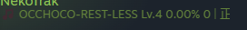

# MuseDashTrak

把 **喵斯快跑（Muse Dash）的打歌状态**实时显示到 **NekoTrak** 的 Steam / Discord 状态栏。

[English](README.md) | 简体中文



```
🔥 OCCHOCO-REST-LESS Lv.4 98.42% 129880 · 258x
🏁 OCCHOCO-REST-LESS Lv.4 99.82% 129880
```

打歌时显示曲名、谱面等级、准确率、分数、连击；结算后短暂保留最终成绩；没在打歌时状态项为空，不会占位。

---

## 原理

```
Muse Dash ──[MelonLoader 插件]──> %LOCALAPPDATA%\MuseDashTrak\status.json
                                              │
NekoTrak 自定义状态  ${...\mdt-status.exe} ───┘
```

* **`MuseDashTrak.dll`**：MelonLoader 插件，每 0.5 秒通过 `GameAssembly.dll` 导出的 `il2cpp_*` API，按名字读取 `GlobalDataBase.s_DbBattleStage`、`TaskStageTarget`、`BattleRoleAttributeComponent` 等对象，写出 `status.json`。全部按名字解析，不写死内存偏移，游戏小版本更新一般不用改。
* **`mdt-status.exe`**：NekoTrak 每次刷新状态时执行一次，读取 `status.json` 并输出一行文字。
* **NekoTrak**：安装脚本会往 `steamSyncItems` 里加一条 `{"type":"custom","text":"${...\mdt-status.exe}"}`，NekoTrak 执行 `${...}` 并用输出替换。

---

## 环境要求

| | |
|---|---|
| 系统 | Windows 10 / 11 (x64) |
| 游戏 | [Muse Dash](https://store.steampowered.com/app/774171/Muse_Dash/)（Steam 版） |
| 宿主 | [NekoTrak](https://store.steampowered.com/app/5249210/NekoTrak/) 1.3.x |
| 模组加载器 | [MelonLoader](https://github.com/LavaGang/MelonLoader) 0.7.0（安装脚本自动下载） |

---

## 安装

1. 从 [Releases](../../releases) 下载 `MuseDashTrak-vX.Y.Z.zip`。
2. **完全退出 NekoTrak**（托盘图标 → 退出）和 Muse Dash。
3. 解压，双击 **`install.cmd`**。
4. 打开 NekoTrak，然后**从 Steam 启动** Muse Dash，打一首歌。

首次启动时 MelonLoader 会生成 IL2CPP 程序集（1–3 分钟，会有控制台窗口显示进度），之后启动就很快了。

游戏不在默认路径时：

```powershell
powershell -ExecutionPolicy Bypass -File .\install\install.ps1 -GamePath "E:\SteamLibrary\steamapps\common\Muse Dash"
```

---

## 自定义显示格式

编辑 `%LOCALAPPDATA%\MuseDashTrak\format.txt`：

* 第 1 行：打歌中模板
* 第 2 行：结算模板

| 占位符 | 含义 | 占位符 | 含义 |
|---|---|---|---|
| `{song}` | 曲名 | `{lv}` | ` Lv.9`（未知时为空） |
| `{level}` | 谱面等级数字，如 `9` | `{diffName}` | `EASY` / `HARD` / `MASTER` / `HIDDEN` / `TOUHOU` |
| `{acc}` | 准确率，两位小数 | `{score}` | 分数 |
| `{combo}` | 连击 > 0 时输出 ` · 258x` | `{combos}` | 纯连击数 |
| `{elapsed}` | 已打时长 `m:ss` | `{state}` | `playing` / `result` |

例如：

```
🎧 正在打歌：{song}{lv} {acc}% {score}{combo}
🏁 结算：{song}{lv} {acc}% {score}
```

改完下一轮刷新即生效，不用重启。

---

## 出问题了

运行 **`selfcheck.cmd`**，它会打印安装状态、`status.json`、NekoTrak 实际会显示的那行字，以及 MelonLoader 日志尾部。

| 现象 | 排查方向 |
|---|---|
| 没有 `status.json` | 插件没被加载，看 `MelonLoader\Logs\*.log` |
| 打歌时仍是 `"state":"idle"` | 插件加载了但没识别到战斗 |
| `"error":"unresolved"` | 游戏更新改了类名，看 `diag_unresolved.txt` |
| 状态栏没变化 | 安装后要重启 NekoTrak；确认开了 Steam 同步 |
| 分数/ACC 一直是 0 | 提 issue 时附上 `%LOCALAPPDATA%\MuseDashTrak\diag.txt` |

相关文件：

```
%LOCALAPPDATA%\MuseDashTrak\status.json
%LOCALAPPDATA%\MuseDashTrak\diag.txt
%LOCALAPPDATA%\MuseDashTrak\diag_unresolved.txt
<游戏目录>\MelonLoader\Logs\*.log
```

---

## 卸载

```powershell
powershell -ExecutionPolicy Bypass -File .\install\install.ps1 -Uninstall
```

会删掉插件 DLL、桥接程序和 NekoTrak 状态项。MelonLoader 会保留（其它 mod 可能还在用），要彻底还原就再删游戏目录下的 `version.dll` 和 `MelonLoader\`。

---

## 从源码构建

`build.ps1` 用 Roslyn 和 .NET 6 引用程序集编译两个程序，首次运行会把 MelonLoader 和引用包下载到 `_tools\`（需要 `dotnet` 运行时和 Windows 自带的 `csc.exe`）。

```powershell
powershell -ExecutionPolicy Bypass -File .\build.ps1
powershell -ExecutionPolicy Bypass -File .\release.ps1 -Version 0.1.0
```

目录结构：

```
src/Mod.cs            MelonLoader 插件（P/Invoke 直接调 il2cpp API）
src/mdt-status.cs     控制台桥接程序
install/install.ps1   安装 / 卸载
install/selfcheck.ps1 自检
install/simulate.ps1  写一条假状态，单独验证 NekoTrak 侧
```

---

## 说明

* 插件只**读取**游戏内存，不修改玩法、谱面或成绩。
* 非官方粉丝项目，与 PeroPeroGames（喵斯快跑）、Bocchi The Dev（NekoTrak）无关。
* 游戏更新可能改字段名；遇到问题请附 `diag.txt` 提 issue。
* MelonLoader 由脚本从其官方 GitHub Releases 下载，仓库不内置。

## 致谢

* [MelonLoader](https://github.com/LavaGang/MelonLoader)、[Il2CppInterop](https://github.com/BepInEx/Il2CppInterop)：模组加载与 IL2CPP 互操作
* [MuseDashInfoPlus](https://github.com/KARPED1EM/MuseDashInfoPlus)、[MDRPC](https://github.com/Braasileiro/MDRPC)：喵斯字段结构的先行研究
* NekoTrak 的 `${...}` 自定义状态语法

## 许可

[MIT](LICENSE)
